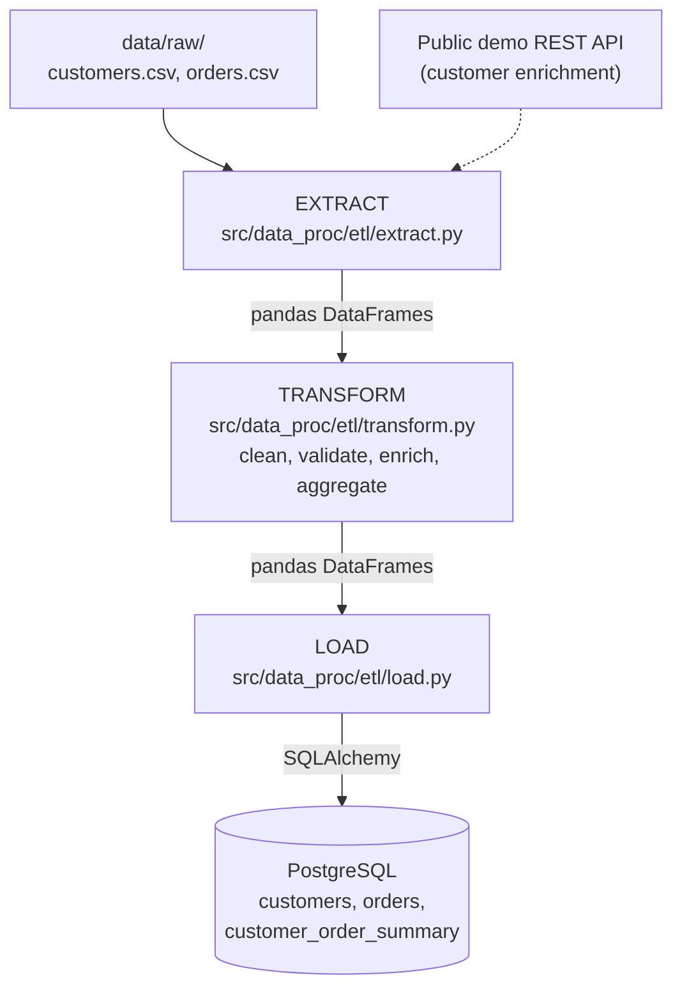
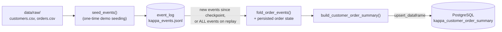
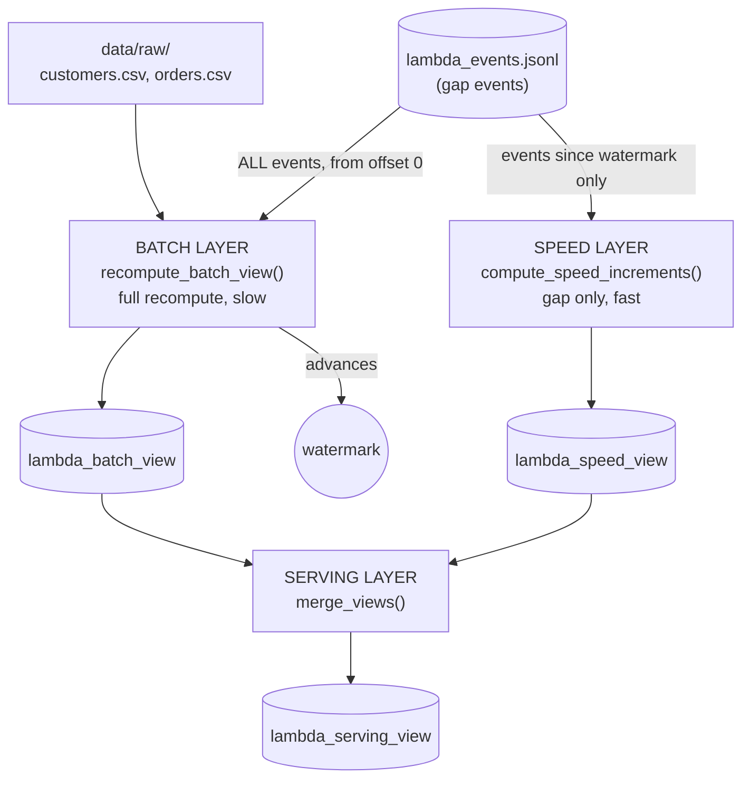
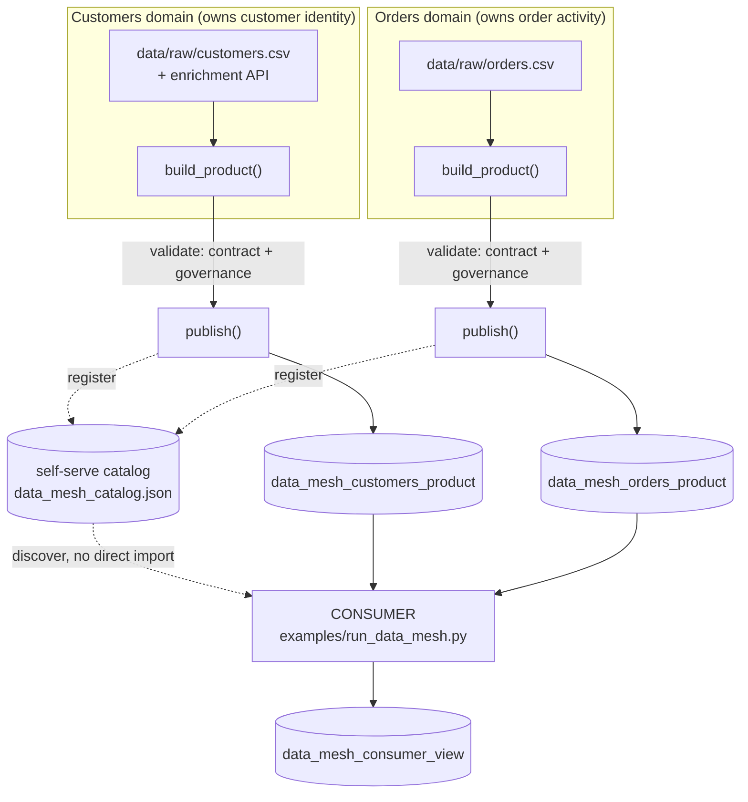

# Architecture

## Overview

This POC implements a classic **batch ETL** (Extract–Transform–Load)
pipeline. It is deliberately simple — a single Python process, no
orchestrator — so the data flow is easy to read end-to-end. The same
structure scales to Airflow/Dagster-orchestrated pipelines, Spark jobs, or
cloud-native services (the `extract` / `transform` / `load` module
boundaries are designed to be swapped out independently).

## Data flow diagram

```text
                    ┌─────────────────────┐
                    │  data/raw/           │
                    │  customers.csv       │
                    │  orders.csv          │
                    └──────────┬──────────┘
                               │
                    ┌──────────▼──────────┐        ┌──────────────────────┐
                    │   EXTRACT            │◄───────┤ Public demo REST API │
                    │ src/data_proc/etl/extract.py   │        │ (customer enrichment)│
                    └──────────┬──────────┘        └──────────────────────┘
                               │ pandas DataFrames
                    ┌──────────▼──────────┐
                    │   TRANSFORM          │
                    │ src/data_proc/etl/transform.py │
                    │ - clean & validate    │
                    │ - compute line totals │
                    │ - enrich customers    │
                    │ - aggregate summary   │
                    └──────────┬──────────┘
                               │ pandas DataFrames
                    ┌──────────▼──────────┐
                    │   LOAD                │
                    │ src/data_proc/etl/load.py       │
                    └──────────┬──────────┘
                               │ SQLAlchemy
                    ┌──────────▼──────────┐
                    │   PostgreSQL          │
                    │ customers             │
                    │ orders                │
                    │ customer_order_summary│
                    └───────────────────────┘
```

The same flow, as an interactive [Mermaid](https://mermaid.js.org/)
diagram (now enabled site-wide — see
[Diagram tooling](#diagram-tooling) below):



## Diagram tooling

This site supports two complementary diagram tools, both enabled in
`mkdocs.yml`:

- **[Mermaid](https://mermaid.js.org/)** — for structural/flow diagrams
  (flowcharts, sequence/state/class diagrams). Write a fenced code block
  with the `mermaid` language tag; Material for MkDocs renders it
  client-side and themes it to match light/dark mode automatically. No
  extra files needed — see the flowchart above for an example.
- **[D3.js](https://d3js.org/)** (v7, loaded from CDN) — for custom,
  data-driven visualizations that Mermaid can't express (e.g. charts
  computed from this repo's sample data). Shared helper functions live in
  `docs/assets/js/d3-diagrams.js` and are loaded on every page via
  `extra_javascript` in `mkdocs.yml`. To add a diagram: embed a `<div>`
  with a unique `id`, then call a helper from an inline `<script>` block
  after it (see the example below, which renders row counts from
  `data/raw/`).

<div id="sample-data-row-counts" class="d3-diagram"></div>
<script>
  window.addEventListener("DOMContentLoaded", function () {
    renderBarChart("#sample-data-row-counts", [
      { label: "customers.csv", value: 10 },
      { label: "orders.csv", value: 20 },
    ]);
  });
</script>

Both tools are additive to the hand-drawn ASCII diagrams used elsewhere in
this repo's docs (e.g. `docs/explanation/concepts.md`) — ASCII stays fine
for quick sketches in prose; reach for Mermaid/D3 when a diagram benefits
from being interactive or rendered from real data.

## Component responsibilities

| Component | File | Responsibility |
|---|---|---|
| Config | `src/data_proc/config.py` | Single source of truth for paths, DB URL, API URL — all overridable via environment variables |
| Extract | `src/data_proc/etl/extract.py` | Pulls raw data from heterogeneous sources (CSV, REST API) into DataFrames; isolates I/O and failure handling |
| Transform | `src/data_proc/etl/transform.py` | Pure functions: cleaning, validation, joins, aggregation — no I/O, easy to unit test |
| Load | `src/data_proc/etl/load.py` | Persists DataFrames via SQLAlchemy; backend-agnostic (Postgres in this demo, SQLite in tests) |
| Pipeline | `examples/run_pipeline.py` | Orchestrates the three stages and logs a run summary |
| Schema | `sql/schema.sql` | Declarative DDL, auto-applied on Postgres container startup |
| Kappa demo | `src/data_proc/kappa/`, `examples/run_kappa_stream.py` | Event-log + replay-based alternative to the batch pipeline — see [Kappa architecture demo](#kappa-architecture-demo) below |
| Lambda demo | `src/data_proc/lambda_arch/`, `examples/run_lambda_architecture.py` | Separate batch + speed layers merged by a serving layer — see [Lambda architecture demo](#lambda-architecture-demo) below |
| Data Mesh demo | `src/data_proc/data_mesh/`, `examples/run_data_mesh.py` | Decentralized domain ownership, data-as-a-product, a self-serve catalog, and federated governance — see [Data Mesh architecture demo](#data-mesh-architecture-demo) below |

## Design decisions

- **DataFrames as the interchange format** between stages keeps each stage
  independently testable and swappable (e.g., replace `extract.py` with a
  Spark DataFrame reader without touching `transform.py`).
- **Resilient API extraction**: the enrichment API call fails soft (logs a
  warning, returns an empty DataFrame) so the demo still runs fully offline.
- **`if_exists="replace"` loads** make the pipeline idempotent and safe to
  re-run repeatedly for demo purposes; a production pipeline would use
  incremental/upsert loads instead (see `docs/explanation/concepts.md`).
- **Docker Compose for Postgres only** — the Python pipeline runs on the
  host (or in CI) so it's trivial to step through with a debugger.

## Extending this POC

- Swap `extract.py`'s CSV reads for a cloud object store (S3/GCS) or a
  streaming source (Kafka) without touching `transform.py` or `load.py`.
- Introduce an orchestrator (Airflow/Dagster/Prefect) that calls
  `run_pipeline.run()` (moving/importing the function from `examples/`
  into the orchestrated project) as a single task, or splits it into
  per-stage tasks with explicit dependencies.
- Add a data-quality layer (e.g., Great Expectations) between transform and
  load to assert invariants before writing to the warehouse.

## Kappa architecture demo

Alongside the batch ETL pipeline above, `src/data_proc/kappa/` +
`examples/run_kappa_stream.py` demonstrate the **Kappa architecture**
pattern: a single, unified stream-processing path, with no separate batch
and speed layers. Where the batch pipeline recomputes everything from a
CSV snapshot on every run (Lambda-style), the Kappa demo instead:

1. Treats an append-only event log (`data/processed/kappa_events.jsonl`,
   `src/data_proc/kappa/event_log.py`) as the single source of truth —
   analogous to a Kafka topic, but file-based for a dependency-free demo.
2. Processes new events incrementally, folding them onto previously
   persisted per-order state (`src/data_proc/kappa/state.py`) and
   advancing a checkpoint (`src/data_proc/kappa/checkpoint.py`).
3. Supports **replay**: resetting the checkpoint and state to zero causes
   the exact same `process()` function in `examples/run_kappa_stream.py`
   to reprocess the entire log from scratch — there is no separate
   backfill/recompute code path to keep in sync, which is the defining
   trait of Kappa versus Lambda.
4. Writes results with `upsert_dataframe()` (`src/data_proc/etl/load.py`)
   into `kappa_customer_order_summary` (`sql/schema.sql`) — an idempotent,
   key-scoped upsert rather than a full-table `replace`, since only a
   subset of customers typically changes per incremental run.



The correctness invariant this demo is built to showcase: folding events
in separate incremental batches (carrying state forward) must produce the
same final state as folding the entire event history at once from empty
state — see `tests/test_kappa_stream_transform.py`'s
`test_incremental_folding_matches_full_replay` for this property verified
directly, and `docs/how-to/run-kappa-demo.md` for a hands-on walkthrough
(seed → process → cancel → replay).

## Lambda architecture demo

Where the Kappa demo above collapses everything into one path, the
**Lambda architecture** — `src/data_proc/lambda_arch/` +
`examples/run_lambda_architecture.py` — deliberately keeps two separate
processing paths, merged at query time:

- **Batch layer** (`batch_layer.recompute_batch_view()`) — slow but
   always-correct: a full, stateless recompute of per-customer order
   aggregates from the CSV snapshot *plus every event in the log so far*,
   written to `lambda_batch_view`. It returns the event-log offset it
   covered, persisted as a **watermark**
   (`watermark.write_watermark()`) marking where the batch layer's
   authority currently ends.
- **Speed layer** (`speed_layer.compute_speed_increments()`) — fast but
   narrow: aggregates only the events strictly after the watermark (the
   "gap"), written to `lambda_speed_view`. It recomputes this small
   window from scratch on every run rather than maintaining persisted
   state, since the gap is assumed small.
- **Serving layer** (`serving_layer.merge_views()`) — the query-time
   merge: outer-joins the batch and speed views by `customer_id`, summing
   counts/spend and taking the max order date, so a consumer querying
   `lambda_serving_view` sees batch completeness plus speed recency
   without the batch layer running continuously.



The same business rule (aggregating orders per customer) is implemented
twice, on purpose — this duplication, and the reconciliation it requires,
is Lambda's best-known maintenance cost and the reason Kappa was proposed
as an alternative. The consistency property this demo is built to
showcase: merging a stale batch view with the speed layer's increment for
a gap must equal what a fresh batch recompute (with that gap's events
already included) would produce — see
`tests/test_lambda_serving_layer.py`'s
`test_serving_result_matches_batch_layer_once_batch_absorbs_the_gap`, and
`docs/how-to/run-lambda-demo.md` for a hands-on walkthrough (batch → seed
gap events → speed+serve → batch again, watching the gap close).

## Data Mesh architecture demo

Where Kappa and Lambda above are both about *how* one team processes data,
**Data Mesh** — `src/data_proc/data_mesh/` + `examples/run_data_mesh.py` —
is an organizational pattern about *who owns* data and *how teams
interoperate* without a central data-engineering bottleneck. This demo
maps its four commonly cited principles onto two independent domains:

- **Domain-oriented decentralized ownership** — `domains/customers_domain.py`
  and `domains/orders_domain.py` each own their own source data and
  publish logic end-to-end. Neither module imports the other; a shared
  utility would be the only acceptable coupling, and this demo has none —
  they share nothing but the generic platform modules below.
- **Data as a product** — each domain publishes a
  `contract.DataContract`-described **data product**, not just a bare
  table: a name, owner, version, free-text description, and a declared
  schema (`contract.validate_schema()` checks a DataFrame against it
  before publish).
- **Self-serve data infrastructure as a platform** — `contract.py` and
  `catalog.py` are the domain-agnostic platform every domain reuses to
  validate and register its product. `examples/run_data_mesh.py`'s
  consumer step discovers both products purely through
  `catalog.get_product()` — it never imports `customers_domain`/
  `orders_domain` directly — demonstrating that a new consumer can be
  added without either domain team's involvement.
- **Federated computational governance** — `governance.py` defines global
  policies (naming convention, non-empty owner, minimum description
  length, declared SLA) once, centrally; each domain's own `publish()`
  function enforces them on itself (`governance.check_global_policies()`)
  before writing anything. Governance is global in *definition*, federated
  in *enforcement* — there is no central gatekeeper service a domain must
  ask permission from.



Unlike Kappa/Lambda's correctness invariants (replay vs. incremental,
batch vs. speed), the property this demo is built to showcase is a
*boundary* invariant: `customers_domain`'s product never contains order
fields and `orders_domain`'s product never contains customer identity
fields — see `tests/test_data_mesh_domains.py`'s
`test_customers_domain_build_product_contains_no_order_fields` and
`test_orders_domain_build_product_contains_no_customer_identity_fields`.
A non-compliant product (bad naming, missing owner, undeclared column)
is rejected by `publish()` before it ever reaches the catalog or a table
— see `tests/test_data_mesh_contract.py` and
`tests/test_data_mesh_governance.py`. For a hands-on walkthrough, see
`docs/how-to/run-data-mesh-demo.md`.
