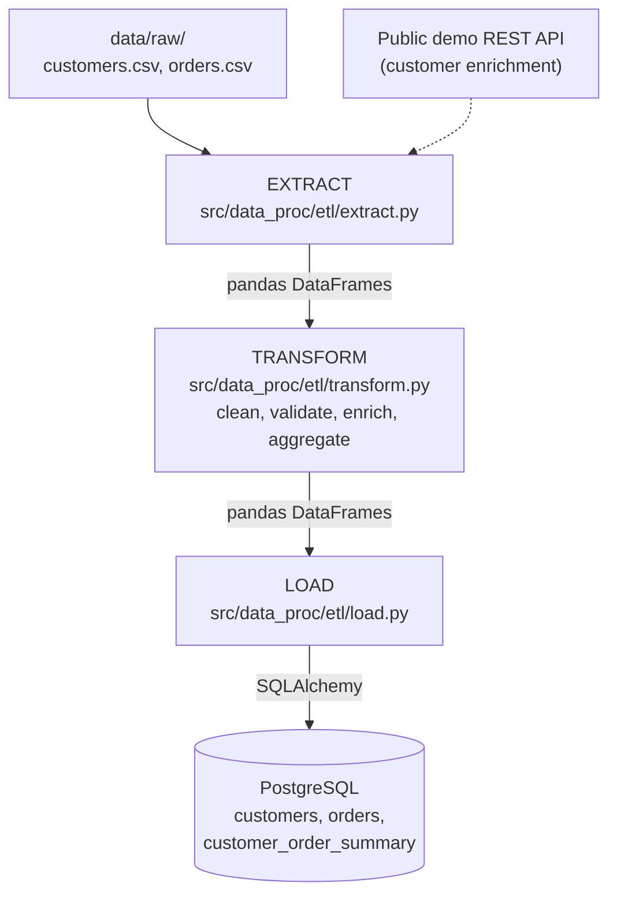

# Architecture

## Overview

This POC implements a classic **batch ETL** (Extract–Transform–Load)
pipeline. It is deliberately simple — a single Python process, no
orchestrator — so the data flow is easy to read end-to-end. The same
structure scales to Airflow/Dagster-orchestrated pipelines, Spark jobs, or
cloud-native services (the `extract` / `transform` / `load` module
boundaries are designed to be swapped out independently).

## Data flow diagram

```text
                    ┌─────────────────────┐
                    │  data/raw/           │
                    │  customers.csv       │
                    │  orders.csv          │
                    └──────────┬──────────┘
                               │
                    ┌──────────▼──────────┐        ┌──────────────────────┐
                    │   EXTRACT            │◄───────┤ Public demo REST API │
                    │ src/data_proc/etl/extract.py   │        │ (customer enrichment)│
                    └──────────┬──────────┘        └──────────────────────┘
                               │ pandas DataFrames
                    ┌──────────▼──────────┐
                    │   TRANSFORM          │
                    │ src/data_proc/etl/transform.py │
                    │ - clean & validate    │
                    │ - compute line totals │
                    │ - enrich customers    │
                    │ - aggregate summary   │
                    └──────────┬──────────┘
                               │ pandas DataFrames
                    ┌──────────▼──────────┐
                    │   LOAD                │
                    │ src/data_proc/etl/load.py       │
                    └──────────┬──────────┘
                               │ SQLAlchemy
                    ┌──────────▼──────────┐
                    │   PostgreSQL          │
                    │ customers             │
                    │ orders                │
                    │ customer_order_summary│
                    └───────────────────────┘
```

The same flow, as an interactive [Mermaid](https://mermaid.js.org/)
diagram (now enabled site-wide — see
[Diagram tooling](#diagram-tooling) below):



## Diagram tooling

This site supports two complementary diagram tools, both enabled in
`mkdocs.yml`:

- **[Mermaid](https://mermaid.js.org/)** — for structural/flow diagrams
  (flowcharts, sequence/state/class diagrams). Write a fenced code block
  with the `mermaid` language tag; Material for MkDocs renders it
  client-side and themes it to match light/dark mode automatically. No
  extra files needed — see the flowchart above for an example.
- **[D3.js](https://d3js.org/)** (v7, loaded from CDN) — for custom,
  data-driven visualizations that Mermaid can't express (e.g. charts
  computed from this repo's sample data). Shared helper functions live in
  `docs/assets/js/d3-diagrams.js` and are loaded on every page via
  `extra_javascript` in `mkdocs.yml`. To add a diagram: embed a `<div>`
  with a unique `id`, then call a helper from an inline `<script>` block
  after it (see the example below, which renders row counts from
  `data/raw/`).

<div id="sample-data-row-counts" class="d3-diagram"></div>
<script>
  window.addEventListener("DOMContentLoaded", function () {
    renderBarChart("#sample-data-row-counts", [
      { label: "customers.csv", value: 10 },
      { label: "orders.csv", value: 20 },
    ]);
  });
</script>

Both tools are additive to the hand-drawn ASCII diagrams used elsewhere in
this repo's docs (e.g. `docs/explanation/concepts.md`) — ASCII stays fine
for quick sketches in prose; reach for Mermaid/D3 when a diagram benefits
from being interactive or rendered from real data.

## Component responsibilities

| Component | File | Responsibility |
|---|---|---|
| Config | `src/data_proc/config.py` | Single source of truth for paths, DB URL, API URL — all overridable via environment variables |
| Extract | `src/data_proc/etl/extract.py` | Pulls raw data from heterogeneous sources (CSV, REST API) into DataFrames; isolates I/O and failure handling |
| Transform | `src/data_proc/etl/transform.py` | Pure functions: cleaning, validation, joins, aggregation — no I/O, easy to unit test |
| Load | `src/data_proc/etl/load.py` | Persists DataFrames via SQLAlchemy; backend-agnostic (Postgres in this demo, SQLite in tests) |
| Pipeline | `examples/run_pipeline.py` | Orchestrates the three stages and logs a run summary |
| Schema | `sql/schema.sql` | Declarative DDL, auto-applied on Postgres container startup |

## Design decisions

- **DataFrames as the interchange format** between stages keeps each stage
  independently testable and swappable (e.g., replace `extract.py` with a
  Spark DataFrame reader without touching `transform.py`).
- **Resilient API extraction**: the enrichment API call fails soft (logs a
  warning, returns an empty DataFrame) so the demo still runs fully offline.
- **`if_exists="replace"` loads** make the pipeline idempotent and safe to
  re-run repeatedly for demo purposes; a production pipeline would use
  incremental/upsert loads instead (see `docs/explanation/concepts.md`).
- **Docker Compose for Postgres only** — the Python pipeline runs on the
  host (or in CI) so it's trivial to step through with a debugger.

## Extending this POC

- Swap `extract.py`'s CSV reads for a cloud object store (S3/GCS) or a
  streaming source (Kafka) without touching `transform.py` or `load.py`.
- Introduce an orchestrator (Airflow/Dagster/Prefect) that calls
  `run_pipeline.run()` (moving/importing the function from `examples/`
  into the orchestrated project) as a single task, or splits it into
  per-stage tasks with explicit dependencies.
- Add a data-quality layer (e.g., Great Expectations) between transform and
  load to assert invariants before writing to the warehouse.
