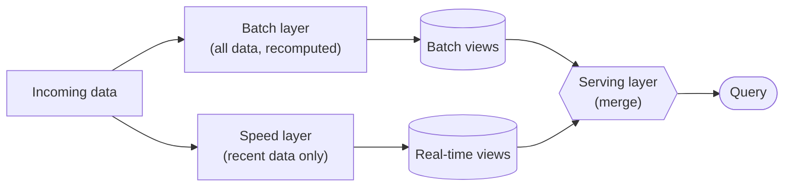
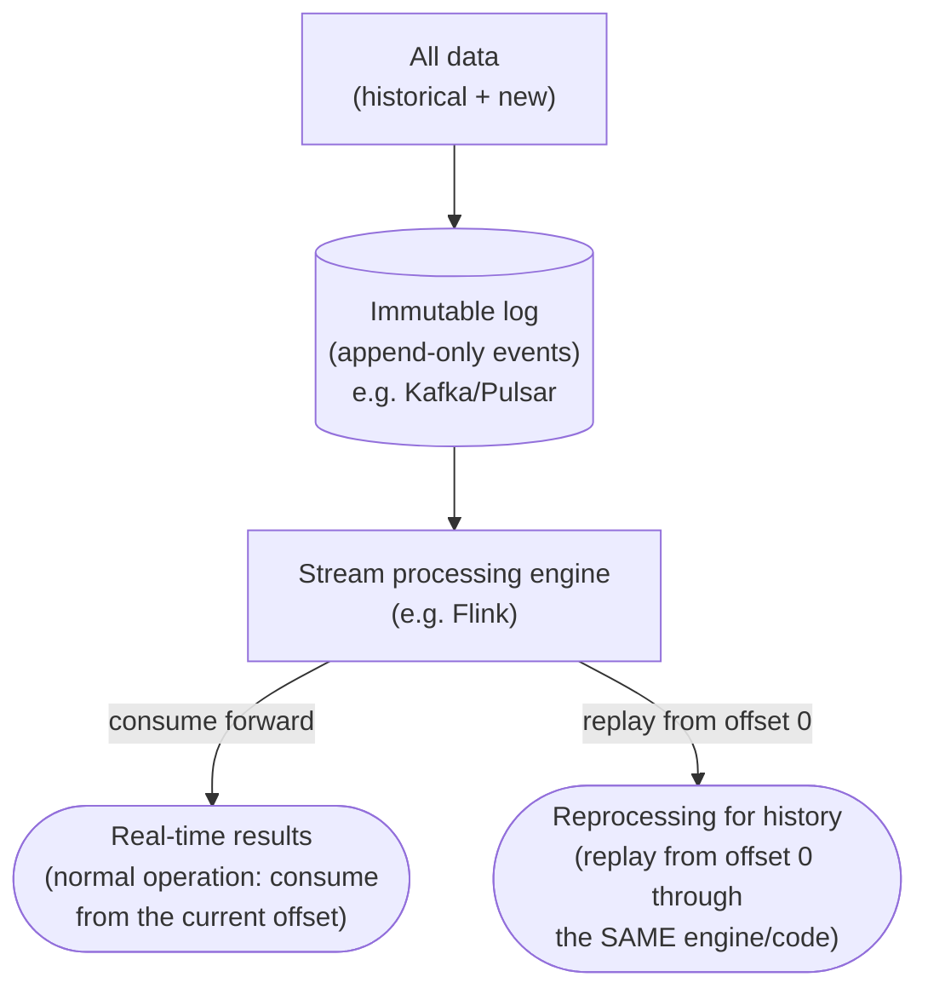
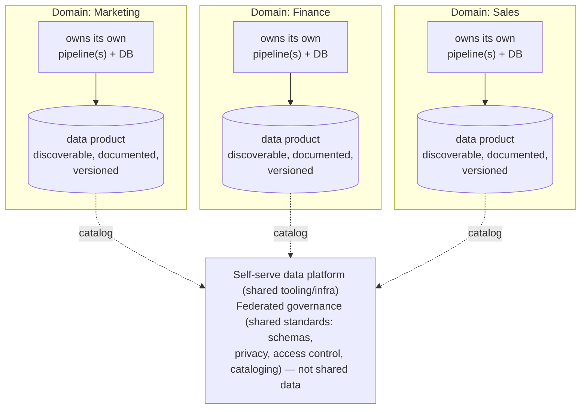
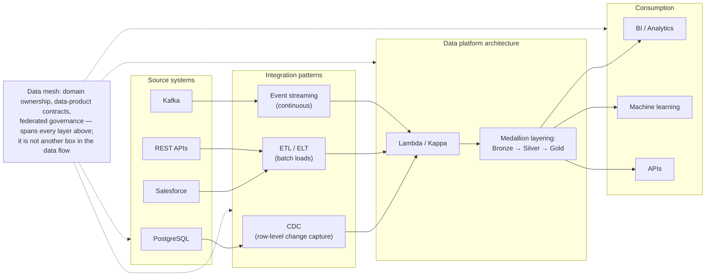

# Data Engineering Concepts Illustrated

This POC is a teaching vehicle for the following foundational data
engineering concepts. Each links to where it's implemented in the code.

## 1. ETL (Extract, Transform, Load)

The three-stage pattern that structures most batch data pipelines:
pull data from source systems, reshape/clean it, then persist it to a
destination optimized for querying.
→ `src/data_proc/etl/extract.py`, `src/data_proc/etl/transform.py`, `src/data_proc/etl/load.py`

## 2. Data processing patterns: how work gets triggered

ETL describes *what* the pipeline does to data; the processing pattern
describes *when*/*how often* it runs. The three common patterns, in order
of increasing latency requirements and operational complexity:

| Pattern | Trigger | Latency | Example use case |
| --- | --- | --- | --- |
| **Batch processing** | Scheduled (hourly/daily) or manually invoked | Minutes–hours | Nightly sales reports, monthly billing |
| **Micro-batching** | Fixed small interval (seconds–minutes) or size threshold | Seconds–minutes | Near-real-time dashboards, periodic fraud scoring |
| **Stream processing** | Continuous, event-by-event as data arrives | Milliseconds–seconds | Live fraud detection, real-time alerting |

This repo implements **batch processing**: `pipeline.run()` reads the full
contents of `data/raw/*.csv` on every invocation and reloads the target
tables from scratch (see "Idempotent loads" below). It is invoked on
demand (`uv run python examples/run_pipeline.py`) or, in production, by a
scheduler (cron, Airflow, Dagster) — the pipeline code itself has no
notion of scheduling.

**Evolving this demo toward the other patterns:**

- **Micro-batching** — keep the same `extract → transform → load`
  structure, but call `pipeline.run()` on a short fixed interval
  (e.g., every 60s) against only the rows that changed since the last run
  (a watermark/cursor on `order_date` or a modified-at column), instead of
  the full CSV each time. This is the natural next step before adopting a
  streaming system, and many "streaming" pipelines in practice are really
  micro-batches under the hood (e.g., Spark Structured Streaming's default
  trigger, or scheduled jobs running every few minutes).
- **Stream processing** — replace `extract_orders_csv()` with a continuous
  event source (e.g., a Kafka consumer or a database change-data-capture
  feed), and replace the batch `transform`/`load` calls with per-event (or
  small-window) handlers. This requires rethinking aggregation: an
  all-at-once `groupby` like `build_customer_order_summary` becomes a
  stateful running aggregate (e.g., windowed counts/sums) maintained
  incrementally as events arrive, since there's no longer a fixed, complete
  input to group over.

The deciding factors when choosing a pattern are: how fresh the output
needs to be, how large/continuous the input volume is, and how much
operational complexity (state management, backpressure, exactly-once
semantics) the team can support. Batch is the simplest to build, test, and
reason about — which is why this demo starts there.

### Full pattern classification

Batch/micro-batch/stream only classify processing along one axis — *when*
work is triggered. In practice, data engineers describe a pipeline along
several independent axes at once, and the vocabulary below covers all of
them:

| Pattern | Description | Typical use case |
| --- | --- | --- |
| Batch processing | Processes bounded datasets | Daily ETL, financial reporting |
| Micro-batch processing | Processes newly available data in small batches | Spark Structured Streaming |
| Stream processing | Continuously processes unbounded data | Fraud detection, IoT |
| Event-driven processing | Initiates processing in response to events | S3 file arrival, order events |
| Incremental processing | Processes only new or changed records | CDC, incremental Delta `MERGE` |
| Full refresh processing | Reprocesses the entire dataset | Small reference tables |
| Parallel processing | Splits computation across workers or cores | Spark distributed transformations |
| Distributed processing | Executes workloads across multiple machines | Spark, Flink |
| Stateful processing | Maintains information across records/events | Window aggregation, stream joins |
| Stateless processing | Processes each record without retaining cross-record state | Filtering, mapping |
| Window-based processing | Groups data into time or count windows | Five-minute sales totals |
| Lambda processing | Combines batch and speed processing paths | Historical + real-time analytics |
| Kappa processing | Uses a unified stream-processing path | Event-driven analytics with replay |
| MapReduce processing | Map, shuffle, and reduce operations | Large-scale aggregation |
| MPP processing | Executes analytical queries across parallel compute nodes | Databricks SQL, Redshift |

These aren't mutually exclusive — they're answers to different questions
about the same pipeline, not alternatives to pick one from:

- **When does it run?** batch / micro-batch / stream / event-driven
- **How much does it reprocess?** incremental vs. full refresh
- **Where does it run?** single-process vs. parallel vs. distributed vs. MPP
- **Does it remember anything?** stateful (and window-based, a common
  form of state) vs. stateless
- **How is batch/stream reconciled at the architecture level?** Lambda vs.
  Kappa (see §3–§4) — these describe the *system*, not a single job

A Spark Structured Streaming pipeline can simultaneously be distributed,
micro-batch, incremental, stateful, and window-based — all five labels
describe one job from different angles.

**Where this demo sits**, read across the same axes: it's **batch** (full
CSV read each run) + **full refresh** (`if_exists="replace"`, see
"Idempotent loads") + **stateless** at the per-row transform step
(`clean_customers`, `clean_orders`) + a **stateful** aggregation only at
the very end (`build_customer_order_summary`'s `groupby`) + single-process
(no parallel/distributed/MPP execution — `pandas`, not Spark). Swapping
`pandas` for PySpark (see "Where to go from here") would add the
parallel/distributed/MPP axis without changing any of the others.

For a deeper treatment of these patterns — code-level comparisons,
incremental/CDC `MERGE` examples, windowing, how real platforms combine
several patterns at once, a decision guide, and interview-style Q&A — see
[Data processing patterns: a deeper dive](data-processing-patterns.md).

## 3. Lambda architecture: combining batch and stream

A common way to get both the throughput/correctness of batch processing
*and* the low latency of streaming is the **Lambda architecture**, which
runs two parallel paths over the same incoming data and merges their
results at query time:

This repo implements exactly this split, end-to-end and runnable — see
[Architecture → Lambda architecture demo](architecture.md#lambda-architecture-demo)
(`src/data_proc/lambda_arch/`, `examples/run_lambda_architecture.py`) for
the working `batch_layer`/`speed_layer`/`serving_layer` code this diagram
describes conceptually.

- **Batch layer** — processes the *complete* historical dataset on a
  schedule, recomputing exact, authoritative "batch views." This is
  exactly what `examples/run_pipeline.py` does today: it has strong consistency
  but high latency (the view is only as fresh as the last full run).
- **Speed layer** — processes only data arrived *since* the last batch
  run, producing approximate "real-time views" with low latency, to cover
  the gap while the next batch run catches up.
- **Serving layer** — merges the batch view and the real-time view at
  query time (e.g., batch totals for all-but-today plus a speed-layer
  delta for today) so queries always reflect both historical and very
  recent data.

Mapped onto this repo's `customer_order_summary` table: the batch layer is
the current pipeline recomputing full lifetime totals from all orders; a
speed layer would separately aggregate only orders since the last pipeline
run (e.g., from a queue or a `WHERE order_date > :last_run` query) into a
small "delta" table; the serving layer would be a view/query that adds the
batch total and the speed-layer delta together.

The main trade-off is **complexity**: Lambda requires maintaining two
separate codepaths (batch logic and speed logic, often even in different
frameworks/languages — e.g., Spark for batch, Flink/Storm for speed) that
must independently reproduce the same business logic and stay consistent
with each other.

## 4. Kappa architecture: a single stream-processing codebase

**Kappa architecture** is the alternative to Lambda that removes the batch
layer entirely: all data — historical and new — is treated as a single,
replayable stream, processed by one codebase.

- **Unified codebase** — the same stream-processing logic that produces
  real-time results is also used to recompute historical results, by
  replaying the log from an earlier offset. There is no separate batch
  framework/codebase to keep in sync with the streaming one.
- **Immutable log as system of record** — because the log retains (or can
  reconstruct) full history, "redoing the batch layer" is just "replay the
  stream again," rather than re-running a fundamentally different job.
- **Reprocessing, not two layers** — when transform logic changes (e.g., a
  bug fix to `build_customer_order_summary`'s aggregation), Kappa replays
  the full event history through the corrected stream job to produce
  corrected output, instead of running a parallel batch recompute.

This repo implements exactly this single-path-plus-replay pattern,
runnable end-to-end — see
[Architecture → Kappa architecture demo](architecture.md#kappa-architecture-demo)
(`src/data_proc/kappa/`, `examples/run_kappa_stream.py`) for the working
`event_log`/`stream_transform`/`checkpoint` code this diagram describes
conceptually.

| | Lambda | Kappa |
| --- | --- | --- |
| Codebases | Two (batch + speed), must stay consistent | One (stream only) |
| Historical reprocessing | Re-run the batch layer | Replay the immutable log through the stream engine |
| Typical tooling | Hadoop/Spark (batch) + Storm/Flink (speed) | Kafka/Pulsar (log) + Flink/RisingWave (processing) |
| Operational cost | Higher — two systems to run/debug | Lower — one system, but requires a log durable/long enough to replay |

Kappa isn't a drop-in simplification for every case: it requires the
streaming engine to handle both real-time and bulk-replay workloads well,
and the log retention must cover however far back reprocessing needs to
reach (or history must live in a queryable store the stream job can
rebuild from). Lambda remains a reasonable choice when the batch and
speed logic are genuinely allowed to diverge in accuracy (e.g., an
approximate real-time view is fine as long as the batch view is exact).

## 5. Data mesh: organizational scaling beyond a single pipeline

Lambda and Kappa both answer "how do I process data with the right
latency?" **Data mesh** answers a different question that shows up once an
organization has *many* teams and pipelines: "who owns the data, and how
do independent teams share it without funneling everything through one
central team/platform?"

The four pillars of data mesh (Dehghani's formulation):

- **Domain-oriented ownership** — the team closest to a business domain
  (marketing, finance, sales, service...) owns its data end-to-end,
  instead of handing it off to one central data engineering team. This
  repo's Data Mesh demo implements exactly this split as two independent
  domains, `src/data_proc/data_mesh/domains/customers_domain.py` and
  `orders_domain.py`, each owning its own source data and publish logic
  end-to-end with no shared business logic between them.
- **Data as a product** — each domain publishes its output as a
  discoverable, documented, quality-guaranteed "data product" (not just a
  raw table), with a clear owner and schema contract. The demo's
  `contract.DataContract` dataclass is exactly this: a name, owner,
  version, description, and declared schema that
  `contract.validate_schema()` checks before anything publishes.
- **Self-serve data platform** — a shared platform (infra, orchestration,
  storage, observability tooling) that lets each domain build/operate its
  own pipeline without reinventing infrastructure. The demo's
  `catalog.py` is this platform's discovery piece: a consumer finds a
  domain's product via `catalog.get_product()` without ever importing
  that domain's module (see `examples/run_data_mesh.py`'s consumer step).
  `docker-compose.yml`, `pyproject.toml`'s dependency groups, and the
  pytest/MkDocs tooling in this repo are the same idea at the whole-repo
  level — reusable platform primitives every demo shares.
- **Federated computational governance** — global rules (schema
  conventions, data privacy rules, access control, interoperability
  standards) are agreed on centrally and enforced automatically, but
  applied by each domain to its own data — governance is federated, not
  the data itself centralized. The demo's `governance.check_global_policies()`
  defines these rules once; each domain's own `publish()` function calls
  it on itself before writing anything, rather than a central gatekeeper
  service reviewing every release.

See
[Architecture → Data Mesh architecture demo](architecture.md#data-mesh-architecture-demo)
for the full implementation walkthrough and
[How to run the Data Mesh demo](../how-to/run-data-mesh-demo.md) for a
hands-on tour.

Data mesh is primarily an **organizational/architectural** pattern (who
owns what, how it's shared) rather than a processing-latency pattern like
Lambda/Kappa — a given domain's pipeline can itself be batch, micro-batch,
or streaming. It's a good fit once a single team/pipeline (like this
demo) no longer scales across many independent domains; it's unnecessary
overhead for a project of this repo's size.

## 6. Putting it together: where these patterns fit in a full platform

Sections 3–5 introduce Lambda, Kappa, and Data mesh as if they were
independent choices. In a real enterprise data platform they actually
stack — each pattern answers a different layer's question. A diagram
helps more than more prose here:

Reading the diagram left to right:

- **Source systems** are heterogeneous by nature — operational databases
  (PostgreSQL), SaaS systems (Salesforce), third-party REST APIs, and
  event brokers (Kafka). This demo's own sources (`customers.csv`,
  `orders.csv`, the enrichment API) are a miniature version of this same
  heterogeneity — see "Multi-source ingestion" below.
- **Integration patterns** decide *how* data moves out of a source:
  - **CDC (Change Data Capture)** — tails a source database's write-ahead
    log / binlog (e.g. Postgres logical replication, Debezium) to stream
    row-level inserts/updates/deletes as they happen, without re-reading
    whole tables. It's the usual way an operational database feeds a
    Kappa-style immutable log.
  - **ETL/ELT** — this demo's pattern (see "§1. ETL"): extract a batch,
    transform it (ETL) either before or after loading (ELT) into the
    platform.
  - **Event streaming** — source systems publish discrete events (e.g.
    "order placed") directly onto a broker like Kafka, rather than
    something external polling/tailing them.
- **Data platform architecture** combines two orthogonal choices:
  - *Processing model* — Lambda or Kappa (see §3–4): how batch and
    real-time results are reconciled.
  - **Medallion architecture** — a storage-layering convention,
    independent of Lambda vs. Kappa, that organizes data by refinement
    level as it moves through the platform:

    | Layer | Contents | Purpose |
    | --- | --- | --- |
    | Bronze | Raw, as-ingested data (append-only, schema-on-read) | Full fidelity audit trail / replay source |
    | Silver | Cleaned, validated, conformed data | Deduplicated, typed, business-key joined — safe to query directly |
    | Gold | Aggregated, business-level data marts | Pre-joined/aggregated for BI and ML consumption |

    This demo already follows the same shape without naming it: raw
    `data/raw/*.csv` is Bronze, the cleaned/validated DataFrames inside
    `transform.py` are Silver, and `customer_order_summary` is Gold.
    Medallion layering works the same whether the underlying processing
    is Lambda (separate batch/speed paths feeding each layer) or Kappa
    (a single stream job materializing each layer as a view over the log).
- **Consumption** is what the platform exists to serve — BI dashboards,
  ad hoc analytics, ML training/inference, and APIs — typically reading
  only from the Gold layer, since that's the layer shaped for querying
  rather than for fidelity or correctness.
- **Data mesh does not sit in this left-to-right flow at all.** It's a
  governance pattern *across* the whole diagram: each domain can own its
  own source-to-consumption pipeline (with its own choice of CDC/ETL/
  streaming, Lambda/Kappa, Bronze/Silver/Gold), and the mesh only adds
  the cross-cutting rules (data-product contracts, discoverability,
  shared platform tooling, federated governance) that let those
  independent pipelines interoperate — see §5.

### Interview-ready summary

If asked to explain this in a Data Architect interview, the concise
version is:

> Lambda and Kappa are data processing **architecture patterns** that
> define how batch and streaming workloads are organized. Data mesh is a
> decentralized data architecture **paradigm** focused on domain
> ownership and governance. Data integration patterns such as ETL, ELT,
> CDC, and event-driven integration operate *within* these architectures
> to move and synchronize data between systems.

**Key distinction:** architecture patterns (Lambda, Kappa, Data mesh)
describe the overall system design; integration patterns (ETL/ELT, CDC,
event streaming) describe the mechanisms for connecting and moving data
within that system. The diagram above is one way to see both layers at
once — integration patterns on the left feeding into an architecture
pattern in the middle.

## 7. Multi-source ingestion

Real pipelines rarely read from a single source. This demo combines a
flat-file source (CSV) with an HTTP API source, showing how to normalize
heterogeneous inputs into a common representation (a pandas DataFrame)
before merging them.
→ `extract_customers_csv()` + `extract_customer_enrichment_api()` in
`src/data_proc/etl/extract.py`

## 8. Data cleaning & validation

Raw data is messy. `clean_customers`/`clean_orders` demonstrate common
cleaning operations: trimming whitespace, normalizing case, parsing dates,
deduplication, and dropping records that fail referential checks (an order
with no `customer_id`).
→ `src/data_proc/etl/transform.py`

## 9. Derived/computed fields

`line_total = quantity * unit_price` shows how transformation steps compute
new fields rather than merely passing data through — a precursor to more
complex business-rule logic.

## 10. Aggregation / summarization

`build_customer_order_summary` groups fine-grained transactional data
(orders) into a coarser-grained, analytics-friendly table (one row per
customer with lifetime metrics) — the core idea behind building fact and
summary tables in a warehouse.

## 11. Idempotent loads

Using `if_exists="replace"` makes repeated pipeline runs produce the same
end state, a simple way to achieve idempotency for a demo. Production
systems typically use `MERGE`/`UPSERT`, partition overwrites, or slowly
changing dimension (SCD) strategies instead — see "Where to go from here."

## 12. Separation of concerns / testability

Transform functions are pure (no I/O), which makes them trivial to unit
test with small in-memory fixtures (`tests/test_transform.py`) without a
database or network connection. Extract/Load functions isolate I/O so they
can be tested against lightweight substitutes (SQLite instead of Postgres,
a mocked HTTP client instead of a live API).

## 13. Configuration as code

All environment-specific values (DB connection string, API URL, timeouts)
flow through a single `Settings` object (`src/data_proc/config.py`) sourced from
environment variables — never hardcoded in business logic — so the same
code runs unchanged across local, CI, and production environments.

## Where to go from here

| Concept | How to explore it in this repo |
| --- | --- |
| Orchestration | Wrap `pipeline.run()` in an Airflow DAG or Dagster job |
| Incremental loads | Replace `if_exists="replace"` with an upsert via `ON CONFLICT` |
| Data quality gates | Add Great Expectations/Pandera checks between transform and load |
| Micro-batching | Add a watermark column and loop `pipeline.run()` on a short interval, processing only new/changed rows (see "Data processing patterns") |
| Streaming | Replace the CSV extractor with a Kafka consumer and stateful windowed aggregation (see "Data processing patterns") |
| Lambda architecture | Add a speed-layer job computing a delta table since the last batch run, and a merge view combining it with `customer_order_summary` (see "Lambda architecture") |
| Kappa architecture | Replace the CSV extractor with an immutable log (e.g., Kafka), and recompute history by replaying it through the same stream job instead of running a separate batch pipeline (see "Kappa architecture") |
| Data mesh | Treat `customer_order_summary` as a versioned, documented "data product" owned by a domain team, built on shared platform tooling (this repo's `docker-compose.yml`/`pyproject.toml`) rather than a one-off pipeline (see "Data mesh") |
| Medallion architecture | Rename/organize `data/raw/` as Bronze, `transform.py`'s cleaned DataFrames as Silver, and `customer_order_summary` as Gold — the shape already matches, only the labels are missing (see "Putting it together") |
| CDC (Change Data Capture) | Point a tool like Debezium at the demo Postgres container's write-ahead log and feed row-level change events into the pipeline instead of re-reading `customers`/`orders` wholesale each run (see "Putting it together") |
| Scale | Swap pandas for PySpark DataFrames; the function signatures stay similar |
| Observability | Add structured logging/metrics around each pipeline stage |
