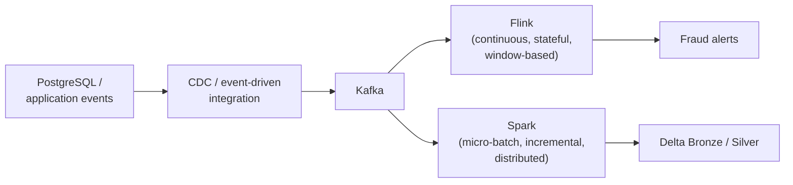

# Data processing patterns: a deeper dive

[Concepts §2](concepts.md#2-data-processing-patterns-how-work-gets-triggered)
introduces batch/micro-batch/stream as the short version, and a broader
15-pattern classification. This page goes one level deeper into the same
topic: how batch, micro-batch, and continuous stream actually differ
under the hood, how incremental processing works in a lakehouse, how
state/windowing work, how real platforms combine several patterns at
once, and a decision guide + interview-prep summary for applying all of
it. Nothing on this page is implemented in this repo (it has no Spark,
Flink, or Delta Lake) — read it as background for designing a platform
this demo could grow into, not as a how-to for this codebase.

For a larger practice set, see
[50 advanced interview questions](data-processing-patterns-interview.md).

## A/B/C: batch, micro-batch, and continuous stream processing

- **A. Batch processing** — collects or reads a finite dataset and
  processes it as one logical job. Suitable for large historical
  computations and scheduled reporting.
- **B. Micro-batch processing** — continuously checks for new input and
  processes it in bounded increments. Spark Structured Streaming's
  default execution engine uses this approach.
- **C. Continuous stream processing** — long-running operators process
  incoming events without waiting for a conventional micro-batch
  boundary. Apache Flink is a common example.

### Comparison

| Dimension | Batch | Micro-batch | Continuous stream |
| --- | --- | --- | --- |
| Input | Bounded | Unbounded, processed in chunks | Unbounded |
| Latency | Minutes to hours, often | Subsecond to seconds or more | Milliseconds to seconds, often |
| Execution | Finite job | Repeated execution | Long-running operators |
| State | Usually job-scoped | Checkpointed across batches | Continuously maintained |
| Frameworks | Spark, SQL | Spark Structured Streaming | Flink, Kafka Streams |
| Complexity | Lower | Medium | Higher |

Latency ranges above are indicative, not guarantees. Spark also has a
distinct continuous-processing execution mode with important feature
limitations.

## Incremental processing

Incremental processing is one of the most important patterns for modern
lakehouse architectures: instead of processing all historical data every
time, the system processes only the changes since a previous successful
execution — e.g., 5,000 changed rows detected out of a 10-million-row
source table, applied as an incremental `MERGE` into Delta Lake (inserts,
updates, and deletes).

Example using PySpark and Delta Lake:

```python
from delta.tables import DeltaTable

target = DeltaTable.forName(spark, "silver.orders")

(
    target.alias("t")
    .merge(
        incremental_df.alias("s"),
        "t.order_id = s.order_id",
    )
    .whenMatchedUpdateAll()
    .whenNotMatchedInsertAll()
    .execute()
)
```

This example assumes `incremental_df` contains one deterministic final
record per order, and does not represent deletes. Production CDC
pipelines must additionally handle source ordering, duplicate events,
tombstones, replay safety, and late-arriving changes.

Common incremental processing techniques:

- Watermark or high-water-mark columns, such as `updated_at`
- Change Data Capture using source logs
- Delta Change Data Feed
- Partition-based incremental processing
- Event offsets and checkpoint tracking
- Snapshot comparison and hash-based change detection

## Stateful vs. stateless processing

**Stateless** — each record is processed independently:

```python
df.filter("amount > 1000")
```

Examples: filter, map, projection, simple enrichment.

**Stateful** — results depend on retained information from multiple
records:

```python
df.groupBy("customer_id").count()
```

Examples: aggregation, deduplication, stream joins, fraud rules.

In streaming systems, stateful processing requires special attention to
checkpointing, state recovery, TTL, watermark-based cleanup, and memory
or disk growth.

## Window-based processing

Windows organize events into finite groups, commonly based on event time
— the three common shapes are **tumbling** (fixed-size, non-overlapping),
**sliding** (fixed-size, overlapping), and **session** (gap-based,
variable-size) windows.

Tumbling window example: aggregate revenue every five minutes, using
Spark Structured Streaming:

```python
from pyspark.sql.functions import window, sum

result = (
    events
    .withWatermark("event_time", "10 minutes")
    .groupBy(
        window("event_time", "5 minutes"),
        "customer_id",
    )
    .agg(sum("amount").alias("total_amount"))
)
```

This defines five-minute tumbling windows with a ten-minute event-time
watermark delay.

## Other important processing patterns

| Pattern | How it works | When to use |
| --- | --- | --- |
| Partitioned processing | Processes data in independent partitions | Large-scale parallel workloads |
| Map-reduce | Map → shuffle → reduce | Distributed aggregations |
| Pipeline processing | Chains processing stages | Multi-stage ETL |
| DAG-based processing | Executes tasks based on dependencies | Spark execution, workflow engines |
| Fan-out/fan-in | Distributes work, then combines results | Parallel enrichment |
| Repartition-and-join | Redistributes records by join key | Large distributed joins |
| Broadcast processing | Replicates a small dataset to workers | Fact-to-small-dimension joins |
| Replay/reprocessing | Reprocesses retained source events | Recovery, logic changes |
| Backfill processing | Recomputes missing or historical data | Late corrections, migrations |
| Idempotent processing | Repeated execution has the same intended effect | Retry-safe pipelines (see "Idempotent loads" in Concepts) |

## How processing patterns combine in real architecture

A production platform commonly combines several patterns, each handling
a different part of the system — not one pattern for the whole platform:



Flink handles low-latency event processing (continuous, stateful,
window-based) off the same Kafka topic that Spark reads for incremental
lakehouse ingestion and transformation (micro-batch, incremental,
distributed) — two separate processing paths over one shared source,
producing two distinct kinds of output.

## Choosing the right pattern — data architect decision guide

Work through these questions in order:

1. **Required processing latency** — hourly/daily, minutes, seconds, or
   milliseconds/subsecond?
2. **Data processing scope** — full dataset, or only new/changed records?
3. **Processing logic** — simple filtering/enrichment/aggregation, or
   complex joins, timers, session state, or CEP (complex event
   processing)?

A common "default" answer for a team starting out, when latency is in
the minutes range and logic is moderately complex: **Spark Structured
Streaming micro-batch processing** — use offsets, CDC, checkpoints, or
watermarks to track changes, prefer stateless operators, and minimize
unnecessary shuffles where possible.

This is a starting point, not a universal answer — final selection also
depends on throughput, cost, correctness guarantees, operational
complexity, and source/sink capabilities. Milliseconds-level latency or
heavy use of timers/CEP usually points to Flink instead (see Q4 below).

## Principal data engineer interview questions

**Q1. Is micro-batch processing the same as incremental processing?**
No. Micro-batch describes *when and how frequently* data is processed.
Incremental describes *which data* is processed. A micro-batch pipeline
can be incremental, but incremental processing can also run once daily.

**Q2. Is Kappa a data processing pattern or data architecture pattern?**
Primarily an architecture pattern that organizes processing around a
unified streaming path. It uses stream processing and replay to support
both current and historical computations (see
[Kappa architecture](concepts.md#4-kappa-architecture-a-single-stream-processing-codebase)).

**Q3. What is the difference between distributed processing and parallel
processing?** Parallel processing executes multiple computations
concurrently. Distributed processing executes across multiple networked
machines. Distributed systems typically use parallelism but also require
network communication, coordination, data partitioning, and fault
recovery.

**Q4. When should we choose Flink over Spark Structured Streaming?**
Flink is particularly suitable when the workload requires low-latency
event-by-event processing, sophisticated event-time handling, large
keyed state, timers, or complex event processing. Spark Structured
Streaming is often attractive when integration with existing Spark, SQL,
and Delta Lake workloads is the priority.

**Q5. Does exactly-once processing guarantee exactly-once business
effects?** Not automatically. A processing engine may recover its
internal state exactly once while an external API, database, or sink
receives duplicate side effects. Idempotency keys, transactional sinks,
or deduplication mechanisms may still be necessary.

## Recommended learning sequence

For Data Architect and Principal Data Engineer preparation, study these
in order:

1. **Execution patterns** — batch, micro-batch, continuous streaming.
2. **Data change patterns** — full refresh, incremental, CDC-driven
   processing.
3. **Distributed computation patterns** — partitioning, shuffle,
   broadcast, MapReduce, DAG execution.
4. **State and time patterns** — stateless, stateful, event-time
   windows, joins, watermarks.
5. **Reliability patterns** — checkpointing, replay, idempotency,
   exactly-once boundaries.
6. **Architectural composition** — Lambda, Kappa, Medallion, and Data
   mesh (see [Putting it together](concepts.md#6-putting-it-together-where-these-patterns-fit-in-a-full-platform)).

The most important architectural skill is not memorizing individual
patterns, but understanding how to combine them to satisfy latency,
correctness, scalability, recoverability, and cost requirements.
